# Relatório Técnico — Infraestrutura de Rede Angra-X

**Grupo:** 03  
**Integrantes:** 
* Julia Yamazaki - RM568438
* Bryan de Almeida - RM568081
* Roberto Flaquer - RM567348
* Daniel de Castro - RM567894
* Kauã Ceolin Camargo - RM567328
* Guilherme Blanco - RM566746

Link do video pitch: https://youtu.be/PgSfoAZfTGs

Link Github: https://github.com/juiyya/AngraX_G3.git
---

## (a) Introdução e Parâmetros do Grupo
Este relatório documenta o projeto e a implementação da infraestrutura de rede para a usina nuclear fictícia Angra-X. O objetivo é garantir a comunicação segura, redundante e integrada entre as zonas de segurança (Perímetro, Área Protegida, Área Vital), a Base de Drones e o Centro de Controle Operacional (CCO). Para o Grupo 03, o bloco de endereçamento disponibilizado foi **10.3.0.0/16**, resultando em 100 hosts necessários para o Perímetro.

---

## (b) Plano VLSM (Memória de Cálculo)

| Segmento | Hosts Necessários | Cálculo (\(2^n - 2\)) | Máscara (Decimal / CIDR) | Tamanho do Bloco |
| :--- | :---: | :---: | :--- | :---: |
| Perímetro | 100 | \(2^7 - 2 = 126\) | 255.255.255.128 (/25) | 128 |
| CCO | 50 | \(2^6 - 2 = 62\) | 255.255.255.192 (/26) | 64 |
| Área Protegida | 45 | \(2^6 - 2 = 62\) | 255.255.255.192 (/26) | 64 |
| Base de Drones | 20 | \(2^5 - 2 = 30\) | 255.255.255.224 (/27) | 32 |
| Área Vital | 12 | \(2^4 - 2 = 14\) | 255.255.255.240 (/28) | 16 |
| Links L1 a L5 | 2 (cada) | \(2^2 - 2 = 2\) | 255.255.255.252 (/30) | 4 |

*(Nota: No CCO, o SRV-DNS-DHCP utiliza o IP 10.3.0.130 e o SRV-WEB-MAIL o IP 10.3.0.131).*

---

## (c) Tabela de Endereçamento e Interfaces

| Sub-rede / Segmento | Rede | Máscara | Gateway | IP do Switch (Gerência) |
| :--- | :--- | :--- | :--- | :--- |
| **Perímetro** | 10.3.0.0 | 255.255.255.128 | 10.3.0.1 | 10.3.0.126 |
| **CCO** | 10.3.0.128 | 255.255.255.192 | 10.3.0.129 | 10.3.0.190 |
| **Área Protegida** | 10.3.0.192 | 255.255.255.192 | 10.3.0.193 | 10.3.0.254 |
| **Base de Drones** | 10.3.1.0 | 255.255.255.224 | 10.3.1.1 | 10.3.1.30 |
| **Área Vital** | 10.3.1.32 | 255.255.255.240 | 10.3.1.33 | 10.3.1.46 |

*Mapeamento de Interfaces:*
*   **R-CCO:** Fa0/0 (LAN), Fa1/0 (L1), Fa2/0 (L2), Fa3/0 (L3).
*   **R-PER:** Fa0/0 (LAN), Fa1/0 (L1), Fa2/0 (L4), Fa4/0 (Drones).
*   **R-PROT:** Fa0/0 (LAN), Fa1/0 (L5), Fa2/0 (L2), Fa3/0 (L4).
*   **R-VIT:** Fa0/0 (LAN), Fa2/0 (L5), Fa3/0 (L3).

---

## (d) Evidências e Testes (Prints)

### R2 — Montagem da Topologia
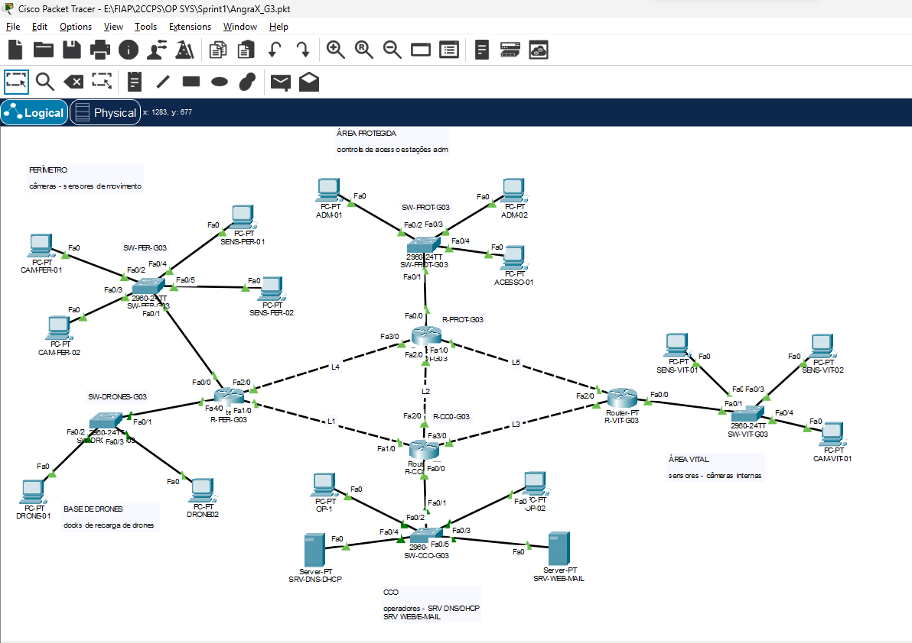

### R4 — Roteamento Dinâmico com RIP e Conectividade
Abaixo está a prova da conectividade total entre o CCO (OP-01) e o Perímetro (CAM-PER-01). O primeiro pacote perdido é comportamento normal do protocolo ARP do simulador.
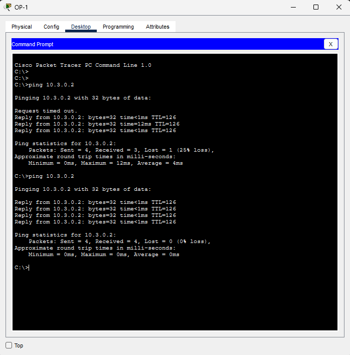

**Tabelas de Roteamento (RIPv2):**
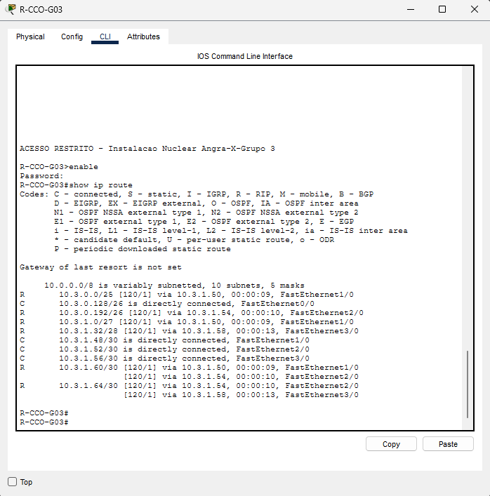
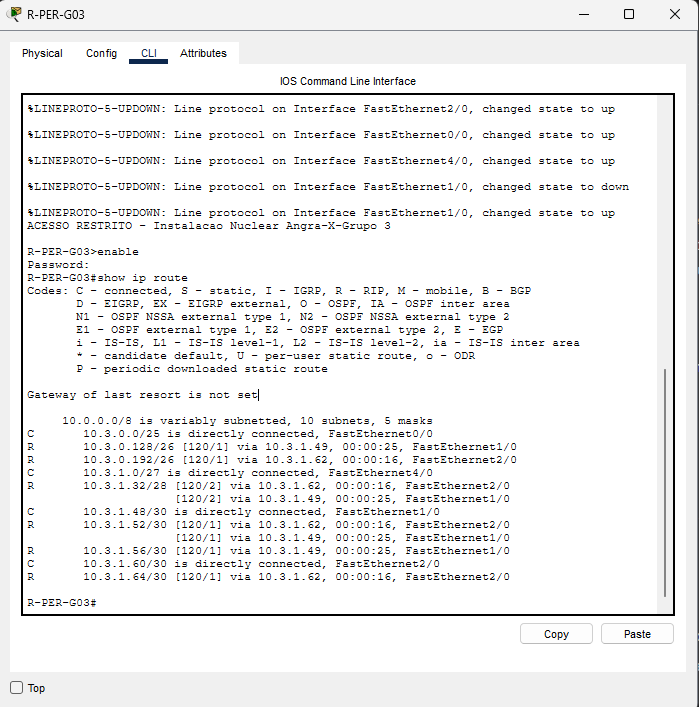
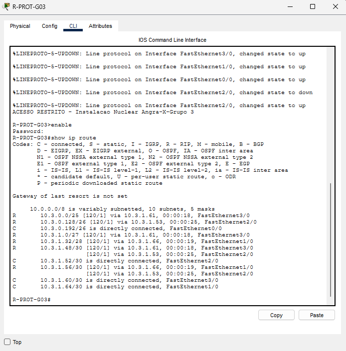

### R5 — Redundância (Queda do Link L3)
**Tracert ANTES da queda do Link L3:**
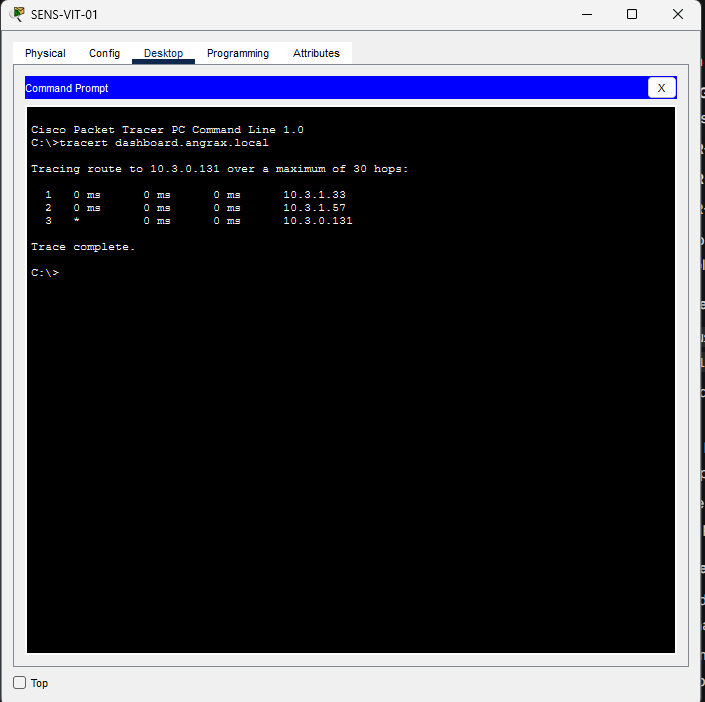

**Derrubando o Link L3 no R-CCO-G03 (Interface Fa3/0):**
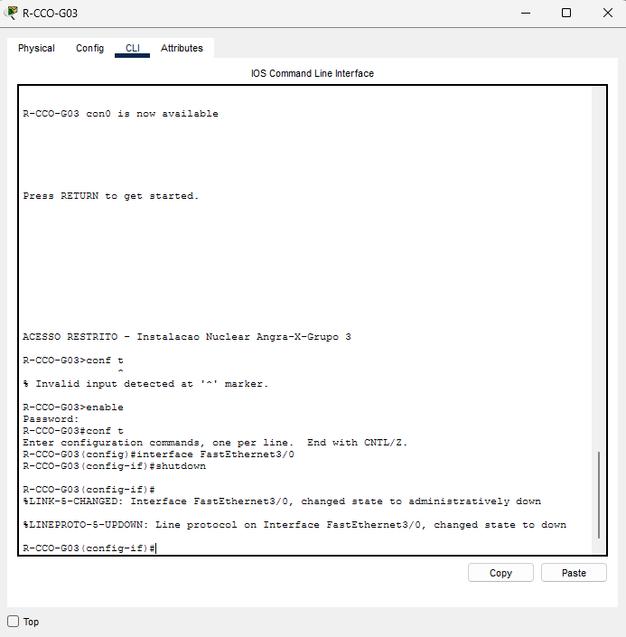

**Show IP Route do R-VIT após queda do L3:** A rota para o CCO sofreu reconvergência, mudando a métrica para [120/2] via R-PROT.
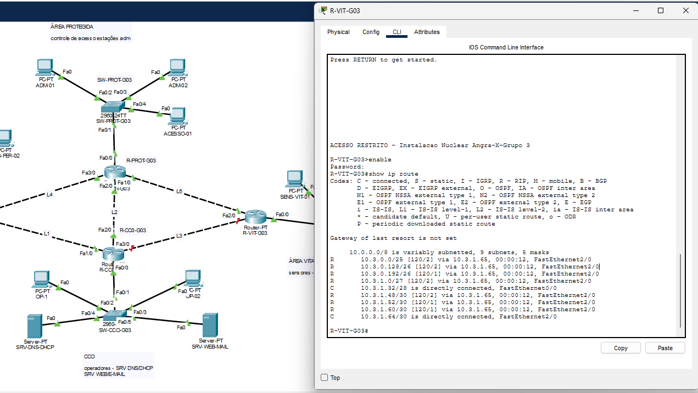

**Tracert DEPOIS da queda do Link L3:** O caminho mudou, passando pelo Roteador da Área Protegida.
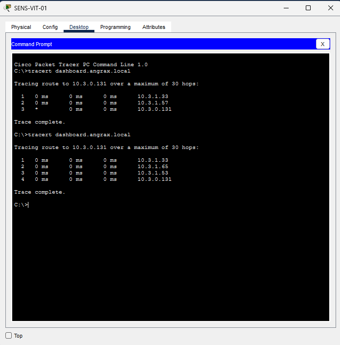

**Queda do Link L1 e Teste de Ping do Perímetro:**
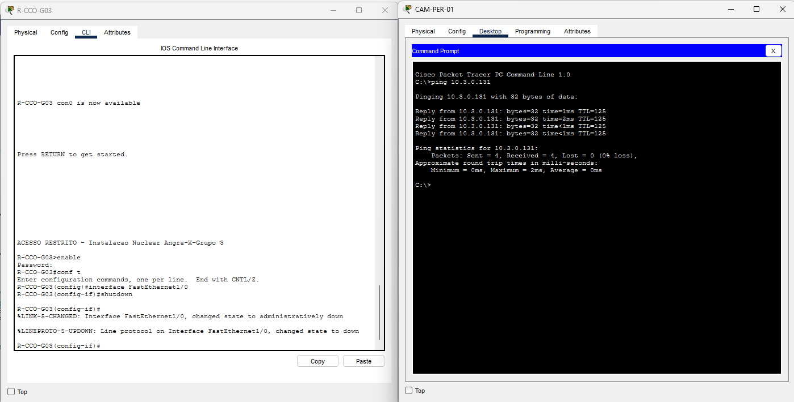

### R6 — Serviços no CCO
**Recebimento de IP via DHCP na estação OP-01:**
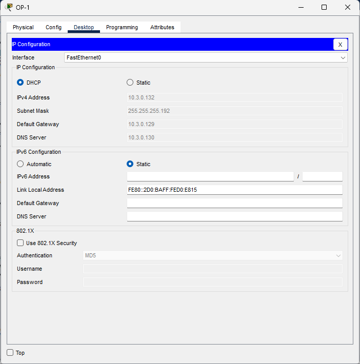

**Acesso à página web via DNS (`dashboard.angrax.local`):**
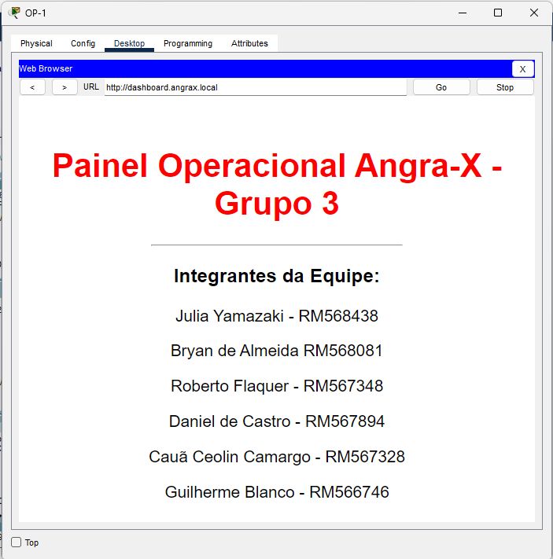

### R7 — Fluxo de Alerta por E-mail
**Envio do alerta a partir do SENS-VIT-01:**
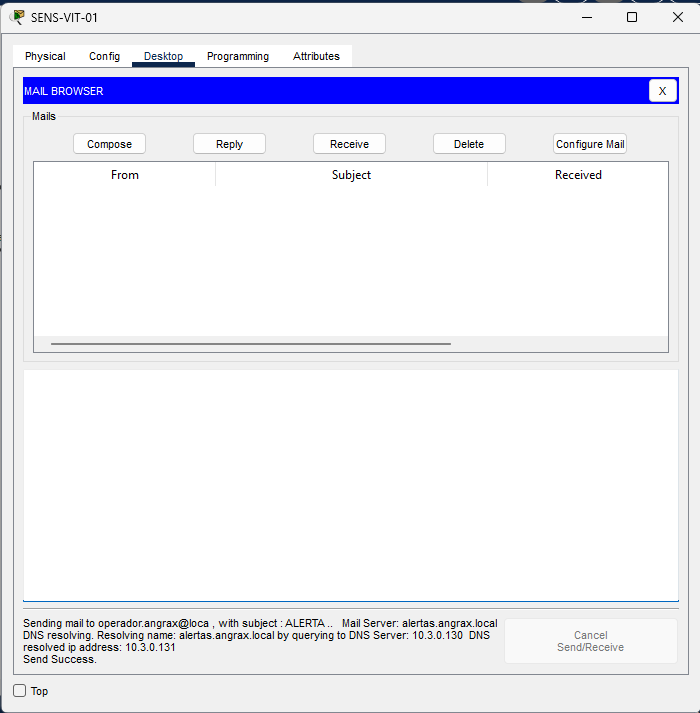

**Recebimento do alerta na caixa de entrada do OP-01:**
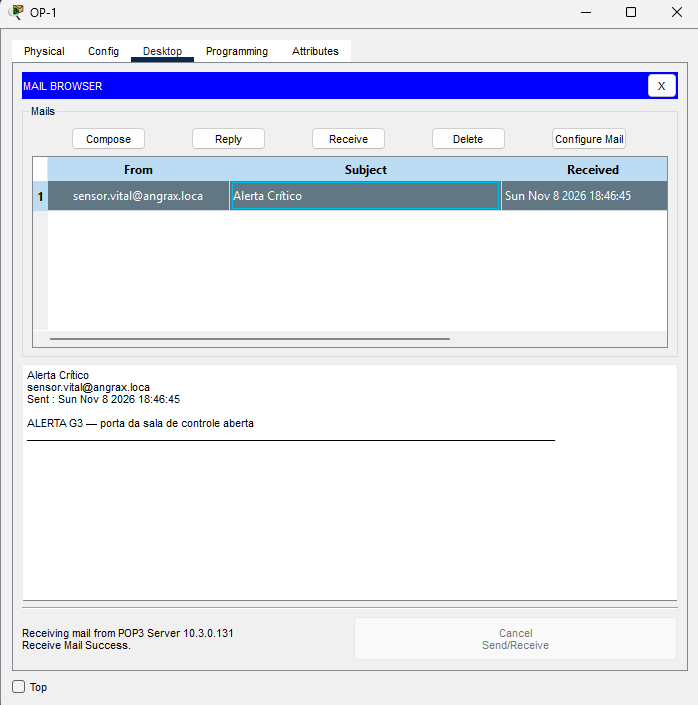

> **Nota sobre o domínio de e-mail:** O domínio ".loca" foi utilizado em vez de ".local" devido a uma limitação de validação de endereço do cliente de e-mail do Cisco Packet Tracer. O serviço de DNS e o roteamento no simulador funcionam perfeitamente com essa adaptação.

---

## (e) Questões Dissertativas

### 1. Estático × DHCP
Sensores, câmeras, servidores e switches usam IP estático porque precisam de endereços previsíveis para que o CCO os encontre de forma confiável. Se um switch ou servidor mudasse de IP, a gerência e os serviços (DNS/HTTP) quebrariam. As estações de operador (OP-01/02) usam DHCP por conveniência, pois são terminais de uso humano e o servidor automatiza a configuração, evitando conflitos de IP e erros de digitação. Se as câmeras dependessem do DHCP e o servidor ficasse fora do ar, elas perderiam o *lease* (tempo de concessão) e ficariam sem IP, cegando o monitoramento da instalação exatamente no momento de falha da infraestrutura.

### 2. RIP versão 2
Este projeto exige o uso do RIPv2 com o comando `no auto-summary` porque a topologia utiliza o método VLSM, criando sub-redes com máscaras variadas a partir do bloco 10.3.0.0/16. O RIPv1 é um protocolo *classful*, ou seja, ele não envia a máscara de sub-rede nas atualizações. Se usado, os roteadores agrupariam as sub-redes de volta para os limites de classe, causando sobreposição e perda de conectividade. O RIPv2 é *classless* e, ao desativar a sumarização automática, permite que cada sub-rede VLSM seja anunciada e roteada corretamente.

### 3. Redundância
Durante o teste do R5, ao derrubar o link L3 (conexão direta entre o R-VIT e o R-CCO), observamos que o RIP reconvergiu rapidamente. O `show ip route` do R-VIT mostrou a rota para o CCO apontando para o R-PROT (IP 10.3.1.65) com métrica 2. O `tracert` confirmou a mudança no caminho e o painel continuou acessível.
Apesar disso, a topologia possui **pontos únicos de falha (SPOF)**: O **R-CCO-G03** (se falhar, isola todas as zonas) e o **SRV-DNS-DHCP** (se falhar, derruba a resolução de nomes e novos IPs). Para eliminá-los, poderíamos usar dois roteadores no núcleo com HSRP/VRRP e um servidor DHCP/DNS secundário em failover.

### 4. Isolamento da Área Vital
Na rede atual, um dispositivo no Perímetro (CAM-PER-01) consegue pingar um sensor na Área Vital (SENS-VIT-01). Isso ocorre porque o RIP anuncia todas as redes e não há ACLs restritivas, o que fere a defesa em profundidade. Em usinas nucleares, a Área Vital deve usar o conceito de *air gap*, sendo isolada de redes externas. Para isso, poderiam ser usadas ACLs estendidas negando o tráfego Perímetro->Vital, Firewalls entre as zonas, ou um Data Diode que só permite a telemetria sair da Área Vital, sem permitir comandos entrarem.

**Comprovação do acesso indevido (Ping do Perímetro para a Área Vital):**
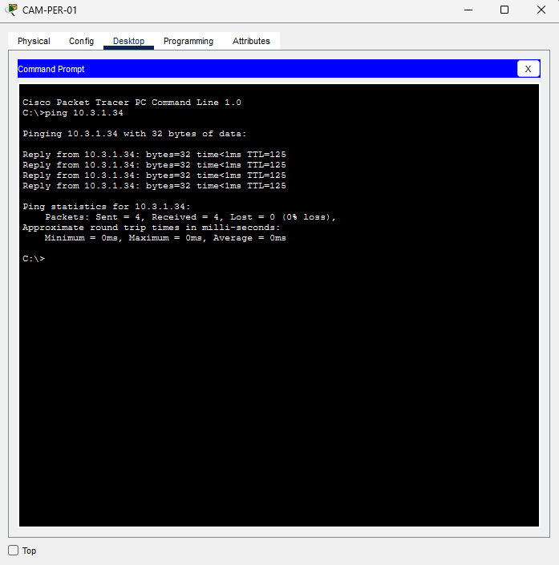

